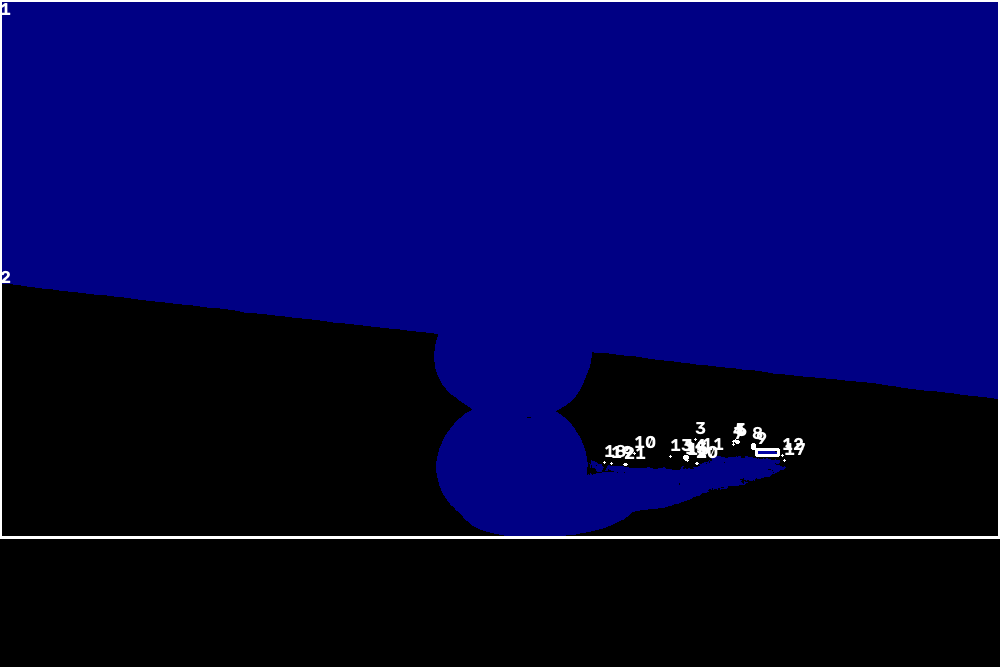
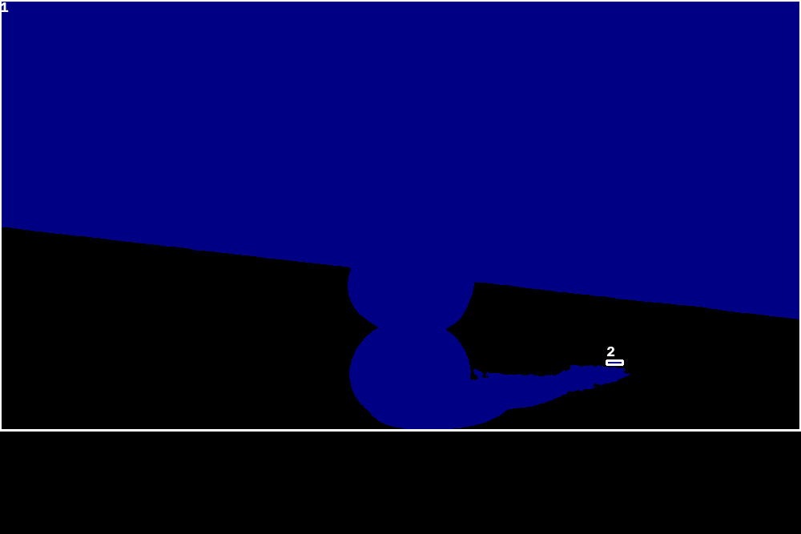

# Processamento Digital de Imagens — Laboratórios M2.1 e M2.2

**Estudante:** João Eduardo Cardoso
**Matrícula:** 7937857
**Linguagem:** Python
**Período:** 2026-02

---

# Parte I — M2.1: Máscara Binária e Segmentação

## 1. Objetivo

O laboratório M2.1 implementa métodos de segmentação de imagens digitais para gerar máscaras binárias de objetos. A atividade tem como objetivos comparar configurações de segmentação, observar suas limitações em imagens reais e selecionar uma configuração inicial para a continuidade do projeto na atividade M2.2.

A implementação permite processar imagens, salvar máscaras em formato PNG e apresentar informações sobre a quantidade e a proporção de pixels classificados como primeiro plano (*foreground*).

O alvo da segmentação é a classe de frutas individuais, sem distinção de espécie, buscando separar visualmente os frutos do fundo. Os experimentos utilizam imagens de limões e laranjas. O objetivo é a segmentação por características visuais, e não o reconhecimento da espécie da fruta.

## 2. Tecnologias utilizadas

- Python 3.12.5 no ambiente experimental.
- OpenCV (`cv2`).
- NumPy.
- pytest.
- Ambiente virtual Python (`venv`).
- Interface de linha de comando (CLI).

O projeto é organizado como um pacote Python chamado `pdi_lab`.

## 3. Estrutura do projeto

A estrutura abaixo apresenta os principais diretórios e arquivos relevantes para as atividades M2:

```text
python/
├── configs/
│   └── morphology.json
├── images/
│   ├── input/
│   ├── output/
│   └── reference/
├── kernels/
├── results/
├── src/
│   └── pdi_lab/
│       ├── __init__.py
│       ├── __main__.py
│       ├── cli.py
│       ├── contract.py
│       ├── errors.py
│       ├── exit_code.py
│       ├── image_io.py
│       ├── kernel.py
│       ├── operations.py
│       ├── parameters.py
│       └── result_io.py
├── tests/
│   ├── sobreposicao.py
│   ├── test_analyze.py
│   ├── test_cli.py
│   ├── test_infrastructure.py
│   ├── test_m1_1.py
│   ├── test_m1_2.py
│   ├── test_m1_3.py
│   └── test_segment.py
├── AI_USAGE.md
├── lab.json
├── pyproject.toml
├── README.md
├── README_M2.md
├── REPORTM1.md
├── REPORTM1_2.md
├── REPORTM1_3.md
├── REPORTM2.md
└── requirements.txt
```

O diretório `src/pdi_lab/` contém a implementação do pacote e da interface de linha de comando. A pasta `tests/` reúne os testes automatizados. As imagens de entrada e saída são organizadas em `images/`, enquanto `configs/` armazena configurações de processamento e `results/` reúne os resultados da análise de componentes conexos.

## 4. Instalação e configuração

### 4.1. Pré-requisitos

É necessário possuir uma instalação do Python 3.10 ou superior. O ambiente utilizado nos experimentos foi o Python 3.12.5.

No Windows, recomenda-se utilizar uma distribuição oficial do CPython compatível com os pacotes declarados em `requirements.txt`.

### 4.2. Criação e ativação do ambiente virtual

A partir do diretório `python/`, execute no PowerShell:

```powershell
python -m venv .venv
.venv\Scripts\Activate.ps1
```

### 4.3. Instalação das dependências

Com o ambiente virtual ativado:

```powershell
python -m pip install -r requirements.txt
python -m pip install -e .
```

O arquivo `requirements.txt` declara as dependências utilizadas pelo projeto e pelos testes automatizados. A instalação em modo editável permite executar o pacote por meio do comando `python -m pdi_lab`.

### 4.4. Verificação da interface

Para consultar os argumentos e as operações disponíveis:

```powershell
python -m pdi_lab --help
```

## 5. Operação de segmentação

A operação `segment` recebe uma imagem de entrada, aplica o método selecionado e salva a máscara resultante no caminho informado.

Formato geral:

```powershell
python -m pdi_lab --input "CAMINHO_DA_ENTRADA" --output "CAMINHO_DA_SAIDA" --operation segment --method METODO
```

Os caminhos podem ser relativos ao diretório do projeto ou absolutos.

### 5.1. Limiar fixo (`fixed`)

O método de limiarização fixa converte uma imagem colorida para escala de cinza e compara a intensidade de cada pixel com um limiar global.

O parâmetro principal é:

- `--threshold`: valor do limiar, entre 0 e 255.

Na limiarização binária convencional, sem inversão, os pixels com intensidade **estritamente maior** que o limiar recebem valor 255, enquanto os pixels com intensidade menor ou igual recebem valor 0.

Com a opção `--invert`, a classificação é invertida: pixels com intensidade menor ou igual ao limiar recebem valor 255, enquanto pixels com intensidade superior recebem valor 0.

Exemplo:

```powershell
python -m pdi_lab --input ".\images\input\laranjas.png" --output ".\images\output\laranjas_fixed.png" --operation segment --method fixed --threshold 160
```

Exemplo com inversão:

```powershell
python -m pdi_lab --input ".\images\input\laranjas.png" --output ".\images\output\laranjas_fixed_invert.png" --operation segment --method fixed --threshold 160 --invert
```

A inversão é útil quando o objeto apresenta intensidades menores que o fundo. Entretanto, ela não resolve automaticamente problemas de iluminação desigual ou sobreposição de intensidades entre objeto e fundo.

### 5.2. Segmentação pelo espaço HSV (`hsv`)

O método HSV converte a imagem do espaço de cores BGR para HSV e seleciona os pixels que se encontram dentro de intervalos de matiz, saturação e valor.

Os parâmetros disponíveis são:

- `--h_min` e `--h_max`: limites de matiz (*Hue*).
- `--s_min` e `--s_max`: limites de saturação (*Saturation*).
- `--v_min` e `--v_max`: limites de valor (*Value*).

Para imagens HSV de 8 bits no OpenCV, os intervalos são:

- H: 0–179.
- S: 0–255.
- V: 0–255.

A configuração utilizada nos experimentos foi:

- H: 5–30.
- S: 60–255.
- V: 40–255.

Exemplo:

```powershell
python -m pdi_lab --input ".\images\input\laranjas.png" --output ".\images\output\laranjas_hsv.png" --operation segment --method hsv --h_min 5 --s_min 60 --v_min 40 --h_max 30 --s_max 255 --v_max 255
```

Essa configuração favorece a seleção de regiões alaranjadas, mas pode incluir elementos do fundo com cores semelhantes às dos objetos.

## 6. Experimentos realizados

Foram executados cinco experimentos com duas imagens de entrada e duas abordagens de segmentação, incluindo uma configuração adicional com inversão do limiar fixo.

### 6.1. Configurações e resultados

| Imagem | Método | Parâmetros | Pixels brancos (255) | Proporção |
|---|---|---|---:|---:|
| `limoes.png` | Fixo | Limiar = 160 | 642.379 | 96,31% |
| `limoes.png` | HSV | H = 5–30; S = 60–255; V = 40–255 | 374.549 | 56,15% |
| `laranjas.png` | Fixo | Limiar = 160 | 666.846 | 99,98% |
| `laranjas.png` | HSV | H = 5–30; S = 60–255; V = 40–255 | 91.407 | 13,70% |
| `laranjas.png` | Fixo com inversão | Limiar = 160; inversão ativada | 154 | 0,02% |

A proporção corresponde à quantidade de pixels classificados como primeiro plano dividida pelo total de pixels da imagem, multiplicada por 100.

A limiarização fixa com valor 160 classificou praticamente toda a imagem como primeiro plano nas duas imagens sem inversão. Já a segmentação HSV produziu máscaras mais seletivas, embora com resultados diferentes entre limões e laranjas.

### 6.2. Máscaras geradas

As imagens abaixo permitem comparar as entradas originais e os resultados dos métodos.

**Imagem original — laranjas**


**Máscara — limiar fixo (160)**


**Máscara — HSV**


**Máscara — limiar fixo (160) invertido**


**Imagem original — limões**


**Máscara — limiar fixo (160)**


**Máscara — HSV**


### 6.3. Análise visual das sobreposições

**Imagem favorável — três laranjas alinhadas**

Na segmentação HSV, o fundo branco é majoritariamente rejeitado devido à sua baixa saturação, enquanto os pixels das laranjas que se encontram dentro do intervalo configurado são selecionados. Visualmente, esse resultado favorece a separação entre os frutos e o fundo.

Entretanto, a qualidade da segmentação também depende da preservação das bordas e das regiões da casca que podem apresentar variações de cor ou iluminação.

Na configuração de limiar fixo, a máscara selecionou 99,98% dos pixels da imagem. Esse resultado indica baixa capacidade de discriminar as frutas do fundo nessa configuração.


**Imagem difícil — pilha de três limões**

Na segmentação HSV, a semelhança de cor entre os limões e partes do cenário dificulta a separação dos objetos. Regiões do fundo com tonalidades dentro do intervalo selecionado podem ser incorporadas à máscara, caracterizando possíveis falsos positivos. Por outro lado, partes das frutas cujos valores de matiz, saturação ou brilho ficam fora do intervalo podem não ser selecionadas, caracterizando possíveis falsos negativos.

A segmentação por limiar fixo também apresenta limitações nessa imagem, devido às variações de intensidade causadas pela iluminação e pelas sombras. Essas falhas podem alterar o contorno aparente dos frutos e comprometer a identificação de objetos individuais na etapa M2.2.


### 6.4. Limitações observadas

O limiar fixo de 160 classificou praticamente todos os pixels como primeiro plano nas duas imagens sem inversão. Esse resultado indica que o limiar escolhido não separou adequadamente os objetos do fundo nesses casos.

Na imagem `laranjas.png`, a configuração fixa com inversão produziu apenas 154 pixels brancos, equivalentes a 0,02% da imagem. Embora a inversão altere a polaridade da classificação, o resultado mostra que o limiar não preservou adequadamente as regiões dos objetos.

A configuração HSV produziu proporções de primeiro plano diferentes entre as imagens. A seleção por cor pode funcionar quando existe distinção cromática suficiente entre objeto e fundo, mas tende a falhar quando ambos compartilham tonalidades semelhantes. Variações de iluminação, sombras e regiões de brilho também podem prejudicar a segmentação.

A proporção de pixels brancos, isoladamente, não permite determinar quais regiões foram segmentadas corretamente. Por isso, a avaliação considera tanto os valores quantitativos quanto a inspeção visual das máscaras.

## 7. Validação das máscaras

As máscaras são geradas em formato PNG. A validação considera:

1. Se a máscara foi salva no caminho informado.
2. Se a largura e a altura correspondem às da imagem de entrada.
3. Se a máscara possui um único canal.
4. Se os valores de pixel são exclusivamente 0 e 255.
5. Se a proporção de pixels brancos pode ser calculada a partir da máscara.

Esses critérios permitem verificar a validade estrutural das máscaras, mas não garantem, por si só, a correção semântica da segmentação.

## 8. Testes automatizados

Os testes de segmentação estão em `tests/test_segment.py`.

Para executar somente esses testes:

```powershell
python -m pytest tests/test_segment.py -v
```

Para executar a suíte completa:

```powershell
python -m pytest -v
```

Os testes de segmentação verificam, entre outros aspectos:

- Limiar fixo com pixels abaixo, iguais e acima do limiar.
- Inversão do limiar fixo.
- Seleção de cores dentro do intervalo HSV.
- Rejeição de imagens em escala de cinza pelo método HSV.
- Processamento das imagens com os métodos fixo e HSV.
- Rejeição de métodos desconhecidos.
- Tratamento de arquivo de entrada inexistente.
- Rejeição de valores inválidos para o limiar fixo.

Na execução registrada durante o desenvolvimento, a suíte completa apresentou 62 testes aprovados, sem falhas.

## 9. Seleção da configuração para a M2.2

A configuração HSV foi selecionada como ponto de partida para a atividade M2.2 por apresentar resultados mais promissores do que o limiar fixo com valor 160 nos experimentos realizados.

Enquanto o limiar fixo classificou praticamente toda a imagem como primeiro plano, o HSV produziu máscaras mais seletivas, favorecendo a identificação das regiões de interesse.

Embora a segmentação HSV ainda apresente limitações, especialmente quando a cor do fundo é semelhante à dos objetos, seus resultados constituem uma base mais adequada para investigar a detecção de contornos e a identificação de múltiplos objetos.

---

# Parte II — M2.2: Componentes Conexos e Sequência Morfológica

## 1. Objetivo

A atividade M2.2 amplia a implementação do laboratório M2.1 para analisar componentes conexos em máscaras binárias e aplicar uma sequência de operações morfológicas.

O objetivo é observar como essas operações modificam a área, os contornos e a conectividade das regiões de primeiro plano, comparando os resultados antes e depois do processamento.

A implementação também permite exportar propriedades geométricas dos componentes, visualizar os rótulos identificados e registrar os parâmetros e as estatísticas de cada experimento.

## 2. Operações implementadas

Foram implementadas as seguintes funcionalidades:

- **Rotulação de componentes conexos:** identificação das regiões de primeiro plano de uma máscara binária, sem incluir o fundo na contagem.
- **Conectividade 4 e 8:** análise dos componentes utilizando diferentes critérios de vizinhança.
- **Extração de propriedades:** cálculo da área em pixels, coordenadas da caixa delimitadora (`x`, `y`), largura, altura e centroide (`cx`, `cy`).
- **Filtragem por área mínima:** classificação dos componentes segundo um limite configurável, mantendo separadas as contagens brutas e filtradas.
- **Abertura morfológica:** erosão seguida de dilatação.
- **Fechamento morfológico:** dilatação seguida de erosão.
- **Visualização dos componentes:** geração de imagens com rótulos e caixas delimitadoras.
- **Exportação dos resultados:** geração de arquivos CSV, imagens intermediárias em PNG e resumos JSON.

A implementação utiliza OpenCV para a rotulação dos componentes e as operações morfológicas. A máscara inicial é preservada para permitir a comparação entre as etapas do processamento.

## 3. Configuração experimental

A sequência morfológica é definida em `configs/morphology.json`, permitindo alterar os parâmetros sem modificar o código-fonte.

A configuração utilizada nos experimentos quantitativos foi:

| Parâmetro | Valor |
|---|---|
| Formato do elemento estruturante | Elíptico |
| Tamanho do kernel | 3 × 3 pixels |
| Iterações por operação | 1 |
| Primeira operação | Abertura (`open`) |
| Segunda operação | Fechamento (`close`) |
| Conectividade da análise | 8 |
| Área mínima | 20 pixels |

A sequência foi escolhida para avaliar dois efeitos distintos. Primeiro, a abertura modifica pequenas estruturas e conexões estreitas que podem representar ruído. Em seguida, o fechamento procura preencher pequenas lacunas e alterar a continuidade das regiões.

A área mínima de 20 pixels é utilizada para determinar quais componentes são mantidos na análise. A filtragem não modifica diretamente a máscara binária; por isso, as contagens brutas e filtradas são registradas separadamente.

## 4. Testes realizados

Os testes automatizados verificam a rotulação, a validação das entradas e os efeitos esperados das operações morfológicas.

| Teste | Critério de verificação |
|---|---|
| Dois pixels na diagonal, conectividade 4 | Identificação de dois componentes |
| Dois pixels na diagonal, conectividade 8 | Identificação de um componente |
| Máscara vazia | Contagem igual a zero |
| Objeto encostado na borda | Identificação correta do componente |
| Soma das áreas | Correspondência entre a soma das áreas brutas e a quantidade de pixels brancos |
| Conectividade inválida | Rejeição de valores diferentes de 4 e 8 |
| Máscara não binária | Rejeição de valores diferentes de 0 e 255 |
| Abertura com ruído isolado | Verificação do efeito previsto no teste |
| Fechamento com pequeno buraco | Verificação do efeito previsto no teste |
| Salvamento dos estágios | Verificação da geração das imagens intermediárias |
| Configuração morfológica inválida | Rejeição da configuração incorreta |

Na execução registrada, os testes específicos do M2.2 totalizaram 15 aprovações. A suíte completa do projeto apresentou 62 testes aprovados, incluindo os testes dos laboratórios anteriores, da segmentação M2.1 e da análise M2.2.

## 5. Resultados experimentais

Foram avaliadas máscaras provenientes das imagens de laranjas e limões. Os experimentos permitem observar tanto as limitações da segmentação inicial quanto as alterações provocadas pelas operações morfológicas.

### 5.1. Experimento 1 — Máscara HSV dos limões

A máscara HSV dos limões apresentou inicialmente 21 componentes com conectividade 8. Ao aplicar o critério de área mínima de 20 pixels, apenas dois componentes foram mantidos.

| Métrica | Máscara inicial | Após abertura | Após fechamento |
|---|---:|---:|---:|
| Componentes brutos | 21 | 3 | 2 |
| Área do primeiro plano (pixels) | 374.549 | 374.443 | 374.485 |

Na abertura, a área diminuiu em 106 pixels, passando de 374.549 para 374.443. Após o fechamento, aumentou em 42 pixels, atingindo 374.485. Considerando a sequência completa, a área final foi reduzida em 64 pixels, aproximadamente 0,017% da área inicial.

A contagem inicial com conectividade 4 foi de 26 componentes, enquanto a conectividade 8 identificou 21 componentes na mesma máscara. A diferença indica que algumas regiões são conectadas diagonalmente e, portanto, são agrupadas quando os vizinhos diagonais também são considerados.

A filtragem por área mínima reduziu a contagem inicial de 21 componentes brutos para dois componentes mantidos. Na máscara final, os dois componentes também foram mantidos.

### 5.2. Experimento 2 — Máscara HSV das laranjas

Na máscara HSV das laranjas, a análise inicial identificou um componente conectado, com área de 91.407 pixels.

| Métrica | Máscara inicial | Após abertura | Após fechamento |
|---|---:|---:|---:|
| Componentes brutos | 1 | 2 | 1 |
| Área do primeiro plano (pixels) | 91.407 | 91.272 | 91.485 |

A abertura reduziu a área do primeiro plano em 135 pixels, passando de 91.407 para 91.272 pixels. Após o fechamento, a área aumentou em 213 pixels, atingindo 91.485 pixels. A variação líquida foi de 78 pixels, aproximadamente 0,085% da área inicial.

A quantidade de componentes passou de um para dois após a abertura e retornou a um após o fechamento. Esse comportamento mostra que as operações morfológicas podem modificar a conectividade das regiões, sem garantir a separação individual dos objetos físicos.

Embora a imagem contenha três frutas, regiões que se tocam podem formar um único componente na máscara binária. Portanto, a contagem igual a um não significa que exista apenas uma fruta, mas que os pixels de primeiro plano formam uma região conectada segundo o critério utilizado.

### 5.3. Comparação entre os experimentos

| Métrica | Limões | Laranjas |
|---|---:|---:|
| Componentes iniciais brutos | 21 | 1 |
| Componentes iniciais mantidos | 2 | 1 |
| Área inicial (pixels) | 374.549 | 91.407 |
| Componentes finais brutos | 2 | 1 |
| Componentes finais mantidos | 2 | 1 |
| Área final (pixels) | 374.485 | 91.485 |
| Variação da área (pixels) | -64 | +78 |

Os resultados evidenciam comportamentos diferentes. Na máscara dos limões, houve redução da quantidade de componentes, de 21 para dois. Na máscara das laranjas, a quantidade final permaneceu igual a um, embora a área tenha aumentado.

A contagem de componentes depende da estrutura da máscara e não corresponde necessariamente à quantidade real de objetos presentes na imagem. A comparação deve considerar simultaneamente as estatísticas e as imagens geradas em cada estágio.

## 6. Figuras e arquivos gerados

O programa salva a máscara inicial, as saídas das operações morfológicas, a máscara final, as visualizações dos componentes, os arquivos CSV e o resumo JSON.

Para o experimento dos limões, os principais arquivos são:

**Máscara inicial**


**Resultado da abertura**


**Resultado do fechamento**


**Máscara final**


**Propriedades dos componentes iniciais**

[Arquivo CSV dos componentes iniciais](results/limoes_hsv_initial.csv)

**Propriedades dos componentes finais**

[Arquivo CSV dos componentes finais](results/limoes_hsv_final.csv)

**Visualização dos componentes iniciais**



**Visualização dos componentes finais**



**Parâmetros e estatísticas da execução**

[Resumo JSON dos limões](results/limoes_hsv_summary.json)

Para as laranjas, são gerados arquivos equivalentes com o prefixo `laranjas_hsv`.

### 6.1. Reprodução dos experimentos

Os experimentos podem ser reproduzidos a partir do diretório `python`, com o ambiente virtual ativado.

**Limões:**

```powershell
python -m pdi_lab --input images/output/limoes_hsv.png --output results/limoes_hsv --operation analyze --connectivity 8 --min-area 20 --config configs/morphology.json
```

**Laranjas:**

```powershell
python -m pdi_lab --input images/output/laranjas_hsv.png --output results/laranjas_hsv --operation analyze --connectivity 8 --min-area 20 --config configs/morphology.json
```

Em ambos os comandos, a entrada é uma máscara binária produzida na atividade M2.1. O parâmetro `--output` define o prefixo dos arquivos gerados, enquanto a configuração morfológica determina o elemento estruturante e a sequência de operações.

## 7. Análise técnica e limitações

### 7.1. Diferença entre conectividade 4 e 8

A conectividade 4 considera como vizinhos os pixels acima, abaixo, à esquerda e à direita. A conectividade 8 também considera os quatro vizinhos diagonais.

Por esse motivo, dois pixels que se tocam somente pela diagonal são considerados componentes separados na conectividade 4 e pertencentes ao mesmo componente na conectividade 8.

Na máscara dos limões, a conectividade 4 identificou 26 componentes, enquanto a conectividade 8 identificou 21. Essa diferença demonstra a influência da escolha de conectividade na interpretação das regiões.

### 7.2. Efeitos da sequência morfológica

Os resultados demonstram que as operações morfológicas alteraram tanto a área quanto a conectividade das regiões de primeiro plano. Entretanto, essas alterações não representam necessariamente uma melhoria da segmentação.

A abertura pode remover pequenos ruídos, mas também eliminar detalhes legítimos ou romper conexões importantes. Da mesma forma, o fechamento pode preencher lacunas, mas também unir regiões que deveriam permanecer separadas.

Por isso, a interpretação dos resultados deve combinar as estatísticas dos componentes com a inspeção visual das máscaras inicial, intermediárias e final.

### 7.3. Limitações da segmentação dos limões

Na imagem dos limões, parte do fundo apresenta cores semelhantes às dos objetos. A segmentação HSV pode incorporar essas regiões à máscara e não representar corretamente todos os frutos. Sombras e variações de iluminação também podem afetar a delimitação dos objetos.

Essa dificuldade antecede a aplicação da morfologia. A abertura e o fechamento modificam os pixels já presentes na máscara, mas não recuperam diretamente as partes dos objetos que foram excluídas durante a segmentação.

O experimento demonstra que a qualidade da máscara inicial limita o resultado final. Mesmo uma sequência morfológica corretamente configurada não resolve necessariamente a semelhança cromática entre objeto e fundo.

### 7.4. Contato entre objetos

Na imagem das laranjas, as três frutas podem formar um único componente porque suas regiões de primeiro plano estão conectadas. A caixa delimitadora final pode englobar toda a região, e o rótulo identifica o componente conectado, não cada fruta individualmente.

A morfologia também pode modificar a conexão entre objetos próximos. Um fechamento pode unir regiões, enquanto uma abertura pode remover conexões estreitas, dependendo do tamanho e da forma do elemento estruturante.

Portanto, a contagem de componentes é uma medida da conectividade da máscara e não equivale necessariamente ao número de objetos físicos. A separação de objetos em contato pode exigir métodos adicionais, como análise de contornos ou watershed.

## 8. Limitações da implementação

A implementação foi desenvolvida para máscaras binárias de um canal, com primeiro plano representado pelo valor 255 e fundo pelo valor 0.

A análise aceita conectividade 4 ou 8 e rejeita valores inválidos. A área mínima é utilizada para classificar os componentes como mantidos ou não mantidos, sem modificar diretamente a máscara binária.

Os parâmetros morfológicos são definidos em `configs/morphology.json`, incluindo a forma e o tamanho do kernel, o número de iterações e a ordem das operações.

Os resultados dependem da qualidade da segmentação inicial, da conectividade escolhida e dos parâmetros morfológicos. A quantidade de componentes, isoladamente, não permite determinar a quantidade real de objetos em imagens com contato, sobreposição ou fragmentação.

## 9. Referências

- [OpenCV — Structural Analysis and Shape Descriptors](https://docs.opencv.org/4.x/d3/dc0/group__imgproc__shape.html)
- [OpenCV — Morphological Transformations](https://docs.opencv.org/4.x/d9/d61/tutorial_py_morphological_ops.html)
- [pytest — Documentação oficial](https://docs.pytest.org/)
- Material e roteiro fornecidos na disciplina de Processamento de Imagens — Laboratórios M2.1 e M2.2.

## 10. Fontes das imagens

As imagens devem ser utilizadas de acordo com as condições de suas respectivas licenças. Confirme se os arquivos utilizados correspondem às fontes e aos conteúdos descritos abaixo.

**Imagem associada a `laranjas.png`**

Fonte: Freepik - Magnific.com. *Três laranjas maduras*. Disponível em: [https://www.magnific.com/br/fotos-gratis/tres-laranjas-maduras_1488434.htm](https://www.magnific.com/br/fotos-gratis/tres-laranjas-maduras_1488434.htm).

Licença informada: gratuita para uso comercial com atribuição (*Free License — With Attribution*). Atribuição indicada: “designed by Freepik - Magnific.com”.

**Imagem associada a `limoes.png`**

Fonte: Freepik - Magnific.com. *Bom alimento para defesas contra doenças*. Disponível em: [https://www.magnific.com/br/fotos-gratis/bom-alimento-para-defesas-contra-doencas_20082390.htm](https://www.magnific.com/br/fotos-gratis/bom-alimento-para-defesas-contra-doencas_20082390.htm).

Licença informada: gratuita para uso comercial com atribuição (*Free License — With Attribution*). Atribuição indicada: “designed by Freepik - Magnific.com”.

## 11. Conclusão geral

As atividades M2.1 e M2.2 permitiram avaliar a segmentação de imagens por limiarização fixa e pelo espaço HSV, bem como os efeitos da conectividade, da filtragem por área mínima e das operações morfológicas sobre máscaras binárias.

Nos experimentos realizados, o HSV produziu máscaras mais seletivas do que o limiar fixo de 160. Entretanto, a semelhança cromática entre objetos e fundo continuou sendo uma limitação relevante. Na análise de componentes conexos, a abertura e o fechamento modificaram a área e a conectividade das regiões, mas não garantiram a identificação individual de todas as frutas.

Conclui-se que a qualidade da máscara inicial influencia diretamente os resultados das etapas posteriores. A análise quantitativa deve ser combinada com a inspeção visual, pois a quantidade de componentes conexos não corresponde necessariamente ao número de objetos físicos presentes na imagem. Para separar objetos em contato ou corrigir regiões do fundo incorporadas à máscara, podem ser necessárias técnicas complementares de segmentação.