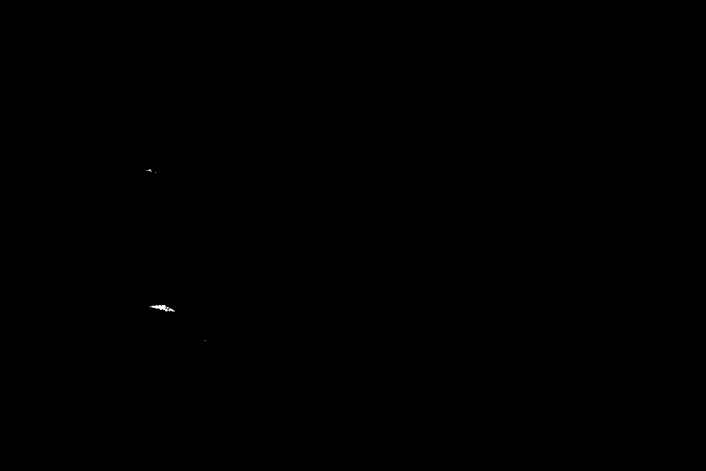
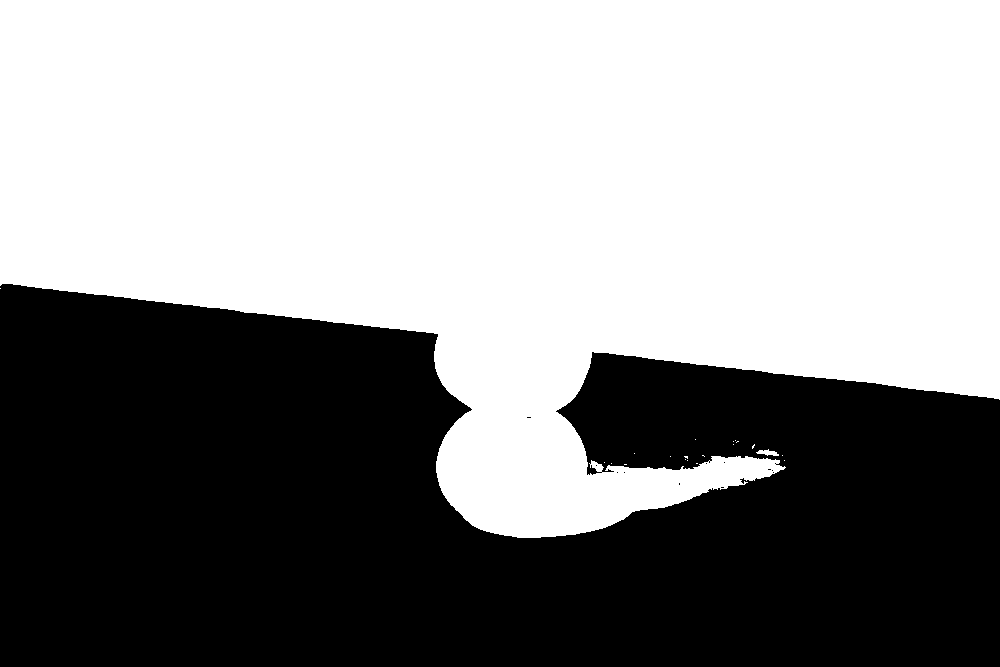
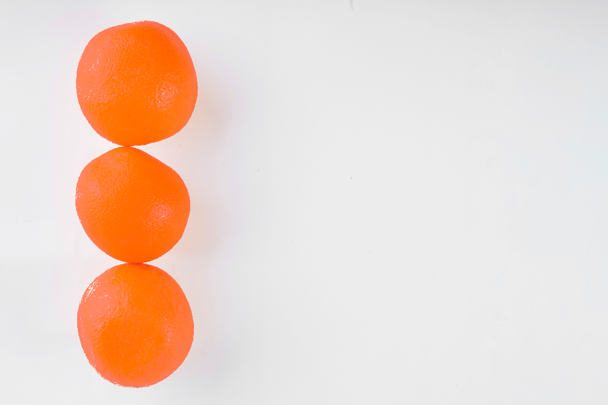

# PDI Lab — M2.1: Máscara Binária e Segmentação

## 1. Objetivo

Este projeto implementa métodos de segmentação de imagens digitais para gerar máscaras binárias de objetos. A atividade M2.1 tem como objetivos comparar configurações de segmentação, observar suas limitações em imagens reais e selecionar uma configuração inicial para a continuidade do projeto na atividade M2.2.

A implementação permite processar imagens, salvar máscaras em formato PNG e apresentar informações sobre a quantidade e a proporção de pixels classificados como primeiro plano (*foreground*).

O alvo da segmentação é a classe de frutas individuais, sem distinção de espécie, buscando separar visualmente os frutos do fundo. Os experimentos utilizam imagens de limões e laranjas; o objetivo é a segmentação por características visuais, e não o reconhecimento da espécie de fruta.

## 2. Tecnologias utilizadas

- Python 3.12.5
- OpenCV (`cv2`)
- pytest
- Ambiente virtual Python (`venv`)
- Interface de linha de comando (CLI)

O projeto é organizado como um pacote Python chamado `pdi_lab`.

## 3. Estrutura do projeto

```text
python/
├── images/
│   ├── input/
│   │   ├── limoes.png
│   │   └── laranjas.png
│   └── output/
│       ├── limoes_fixed.png
│       ├── limoes_hsv.png
│       ├── laranjas_fixed.png
│       ├── laranjas_hsv.png
│       └── laranjas_fixed_invert.png
├── src/
│   └── pdi_lab/
│       ├── __init__.py
│       ├── cli.py
│       ├── image_io.py
│       └── operations.py
├── tests/
│   └── test_segment.py
├── pyproject.toml
└── README.md
```

A estrutura acima representa os arquivos relevantes para a atividade. Outros arquivos de teste ou módulos podem existir no projeto.

## 4. Instalação e configuração

### 4.1. Pré-requisitos

É necessário ter o Python instalado e disponível no terminal.

### 4.2. Ativação do ambiente virtual

No PowerShell, a partir da pasta `python` do projeto:

```powershell
.\.venv\Scripts\Activate.ps1
```

Após a ativação, o terminal deverá apresentar `(.venv)` no início da linha.

### 4.3. Instalação do projeto

Caso o ambiente ainda não esteja configurado, execute:

```powershell
python -m pip install -e .
```

Para executar os testes automatizados, instale o pytest caso ainda não esteja disponível:

```powershell
python -m pip install pytest
```

## 5. Operação de segmentação

A operação `segment` recebe uma imagem de entrada, aplica o método selecionado e salva a máscara resultante no caminho informado.

Formato geral:

```powershell
python -m pdi_lab --input "CAMINHO_DA_ENTRADA" --output "CAMINHO_DA_SAIDA" --operation segment --method METODO
```

Os caminhos podem ser relativos à pasta do projeto ou absolutos.

### 5.1. Limiar fixo (`fixed`)

O método converte uma imagem colorida para escala de cinza e compara a intensidade de cada pixel com um limiar global.

Parâmetro principal:

- `--threshold`: valor do limiar, entre 0 e 255.

Sem inversão, os pixels com intensidade maior ou igual ao limiar são classificados como primeiro plano (`255`); os demais são classificados como fundo (`0`).

Com `--invert`, a classificação é invertida: pixels com intensidade estritamente menor que o limiar recebem `255`, e os demais recebem `0`.

Exemplo:

```powershell
python -m pdi_lab --input ".\images\input\laranjas.png" --output ".\images\output\laranjas_fixed.png" --operation segment --method fixed --threshold 160
```

Exemplo com inversão:

```powershell
python -m pdi_lab --input ".\images\input\laranjas.png" --output ".\images\output\laranjas_fixed_invert.png" --operation segment --method fixed --threshold 160 --invert
```

A inversão é útil quando o objeto apresenta intensidades menores que o fundo. Entretanto, ela não resolve automaticamente problemas de iluminação desigual ou sobreposição de intensidades entre objeto e fundo.

### 5.2. Segmentação por HSV (`hsv`)

O método HSV converte a imagem do espaço de cores BGR para HSV e seleciona pixels dentro de um intervalo de matiz, saturação e valor.

Parâmetros disponíveis:

- `--h_min` e `--h_max`: limites de matiz (*Hue*).
- `--s_min` e `--s_max`: limites de saturação (*Saturation*).
- `--v_min` e `--v_max`: limites de valor ou brilho (*Value*).

Para imagens HSV de 8 bits no OpenCV, os intervalos utilizados são:

- H: 0–179.
- S: 0–255.
- V: 0–255.

Configuração utilizada nos experimentos:

- H: 5–30.
- S: 60–255.
- V: 40–255.

Exemplo:

```powershell
python -m pdi_lab --input ".\images\input\laranjas.png" --output ".\images\output\laranjas_hsv.png" --operation segment --method hsv --h_min 5 --s_min 60 --v_min 40 --h_max 30 --s_max 255 --v_max 255
```

Essa configuração favorece a seleção de regiões alaranjadas, mas pode incluir elementos do fundo com cores semelhantes às dos objetos.

## 6. Experimentos realizados

Foram executados cinco experimentos com duas imagens de entrada e duas abordagens de segmentação, incluindo uma configuração adicional com inversão do limiar fixo.

### 6.1. Configurações e resultados

| Imagem | Método | Parâmetros | Pixels brancos (`255`) | Proporção de pixels brancos |
|---|---|---|---:|---:|
| `limoes.png` | Fixo | Limiar = 160 | 642.379 | 96,31% |
| `limoes.png` | HSV | H = 5–30; S = 60–255; V = 40–255 | 374.549 | 56,15% |
| `laranjas.png` | Fixo | Limiar = 160 | 666.846 | 99,98% |
| `laranjas.png` | HSV | H = 5–30; S = 60–255; V = 40–255 | 91.407 | 13,70% |
| `laranjas.png` | Fixo com inversão | Limiar = 160; inversão ativada | 154 | 0,02% |

A proporção corresponde à quantidade de pixels classificados como primeiro plano dividida pelo total de pixels da imagem, multiplicada por 100.


### 6.2. Máscaras geradas

As imagens abaixo permitem a comparação visual entre as entradas originais e os resultados dos métodos.

**Imagem original — laranjas** 


**Máscara — limiar fixo (160)** 


**Máscara — HSV (H=5–30, S=60–255, V=40–255)**


**Máscara — limiar fixo (160) invertido** 




**Imagem original — limões** 

[alt text](images/input/limoes.png)

**Máscara — limiar fixo (160)** 


**Máscara — HSV (H=5–30, S=60–255, V=40–255)**




### 6.3. Análise visual das sobreposições

**Imagem favorável — três laranjas alinhadas**

Na segmentação HSV, o fundo branco é majoritariamente rejeitado devido à sua baixa saturação, enquanto os pixels das laranjas que se encontram dentro do intervalo configurado são selecionados. Visualmente, esse resultado favorece a separação entre os frutos e o fundo. Entretanto, a qualidade da segmentação também depende da preservação das bordas e de regiões da casca que possam apresentar variações de cor ou iluminação.

Na configuração de limiar fixo utilizada, a máscara selecionou 99,98% dos pixels da imagem. Esse resultado indica baixa capacidade de discriminar as frutas do fundo nessa configuração, pois praticamente toda a imagem foi classificada como primeiro plano.




**Imagem difícil — pilha de três limões**

Na segmentação HSV, a semelhança de cor entre os limões e partes do cenário dificulta a separação dos objetos. Regiões do fundo com tonalidades dentro do intervalo selecionado podem ser incorporadas à máscara, caracterizando possíveis falsos positivos. Por outro lado, partes das frutas cujos valores de matiz, saturação ou brilho ficam fora do intervalo podem não ser selecionadas, caracterizando possíveis falsos negativos.

A segmentação por limiar fixo também apresenta limitações nessa imagem, devido às variações de intensidade causadas pela iluminação e pelas sombras. Essas falhas podem alterar o contorno aparente dos frutos e comprometer a identificação de objetos individuais na etapa M2.2.


### 6.4. Limitações observadas

O limiar fixo de 160 classificou praticamente todos os pixels como primeiro plano nas duas imagens sem inversão. Esse resultado indica que o limiar escolhido não separou adequadamente o objeto do fundo nesses casos.

Na imagem `laranjas.png`, a configuração fixa com inversão produziu apenas 154 pixels brancos, equivalentes a 0,02% da imagem. Embora a inversão altere a polaridade da classificação, o resultado mostra que o limiar não preservou adequadamente as regiões dos objetos.

A configuração HSV produziu proporções de primeiro plano diferentes entre as imagens. A seleção por cor pode funcionar quando existe distinção cromática suficiente entre objeto e fundo, mas tende a falhar quando ambos compartilham tonalidades semelhantes. Variações de iluminação, sombras e regiões de brilho também podem prejudicar a segmentação.

As limitações devem ser confirmadas e ilustradas com as máscaras efetivamente geradas. A proporção de pixels, isoladamente, não permite determinar quais regiões foram segmentadas corretamente.

## 7. Validação das máscaras

As máscaras são geradas em formato PNG para evitar perdas decorrentes de compressão com perdas.

A validação verifica se:

1. A máscara foi salva no caminho informado.
2. A largura e a altura são iguais às da imagem de entrada.
3. A máscara possui um único canal.
4. Os únicos valores de pixel são `0` e `255`.
5. A proporção de pixels brancos pode ser calculada a partir da máscara.

## 8. Testes automatizados

Os testes são implementados em `tests/test_segment.py`.

Para executar somente os testes de segmentação:

```powershell
python -m pytest tests/test_segment.py -v
```

Para executar a suíte completa:

```powershell
python -m pytest -v
```

Os testes de segmentação passaram na execução mais recente apresentada, cobrindo:

- Limiar fixo com pixels abaixo, iguais e acima do limiar.
- Inversão do limiar fixo.
- Seleção de cores dentro do intervalo HSV.
- Rejeição de imagens em escala de cinza pelo método HSV.
- Processamento das duas imagens com os métodos fixo e HSV.
- Processamento adicional com inversão do limiar.
- Rejeição de métodos desconhecidos.
- Tratamento de arquivo de entrada inexistente.
- Rejeição de valores inválidos para o limiar fixo.


## 9. Considerações para a atividade M2.2

A seleção da configuração para a próxima atividade deve considerar a qualidade visual das máscaras e a capacidade de manter objetos distintos separados do fundo.

Como a atividade M2.2 envolve o tratamento de múltiplos objetos, os erros mais relevantes incluem:

- **Falsos positivos:** regiões do fundo classificadas como objeto.
- **Falsos negativos:** regiões do objeto classificadas como fundo.
- **Fragmentação:** um único objeto dividido em várias regiões.
- **Fusão:** objetos distintos ou objeto e fundo unidos na máscara.

Esses problemas podem comprometer a contagem dos objetos e devem ser avaliados visualmente antes de selecionar a configuração definitiva.

A configuração HSV foi selecionada como ponto de partida para a atividade M2.2 por apresentar resultados mais promissores do que o limiar fixo com valor 160 nos experimentos realizados. Enquanto o limiar fixo classificou praticamente toda a imagem como primeiro plano, o HSV produziu máscaras mais seletivas, favorecendo a identificação das regiões de interesse.

Embora a segmentação HSV ainda apresente limitações, especialmente quando a cor do fundo é semelhante à dos objetos, seus resultados constituem uma base mais adequada para investigar a detecção de contornos e a identificação de múltiplos objetos. Na M2.2, será necessário avaliar como essas limitações afetam a delimitação dos objetos e verificar se o processamento adicional permite melhorar sua separação.

## 10. Fontes das imagens

As imagens devem ser utilizadas de acordo com as condições de suas respectivas licenças.

**Imagem associada a `laranjas.png`**


Fonte: Freepik - Magnific.com. *Três laranjas maduras*. Disponível em: https://www.magnific.com/br/fotos-gratis/tres-laranjas-maduras_1488434.htm.

Licença informada: gratuita para uso comercial com atribuição (*Free License — With Attribution*). Atribuição exigida: “designed by Freepik - Magnific.com”.

**Imagem associada a `limoes.png`**


Fonte: Freepik - Magnific.com. *Bom alimento para defesas contra doenças*. Disponível em: https://www.magnific.com/br/fotos-gratis/bom-alimento-para-defesas-contra-doencas_20082390.htm.

Licença informada: gratuita para uso comercial com atribuição (*Free License — With Attribution*). Atribuição exigida: “designed by Freepik - Magnific.com”.

Verifique se os arquivos utilizados correspondem efetivamente às fontes e aos conteúdos descritos acima.

## 11. Conclusão

Para a atividade M2.2, optou-se pela segmentação HSV como configuração inicial, pois ela produziu máscaras mais seletivas do que o limiar fixo de 160 nos experimentos realizados. Essa escolha não implica que o HSV seja superior em todas as condições: a semelhança de cor entre os objetos e o fundo ainda pode causar falsos positivos e falsos negativos. Na próxima etapa, será avaliado como essas limitações afetam a detecção de contornos e a contagem de objetos individuais, e como o HSV trabalha em conjunto com outras soluções de segmentação.
